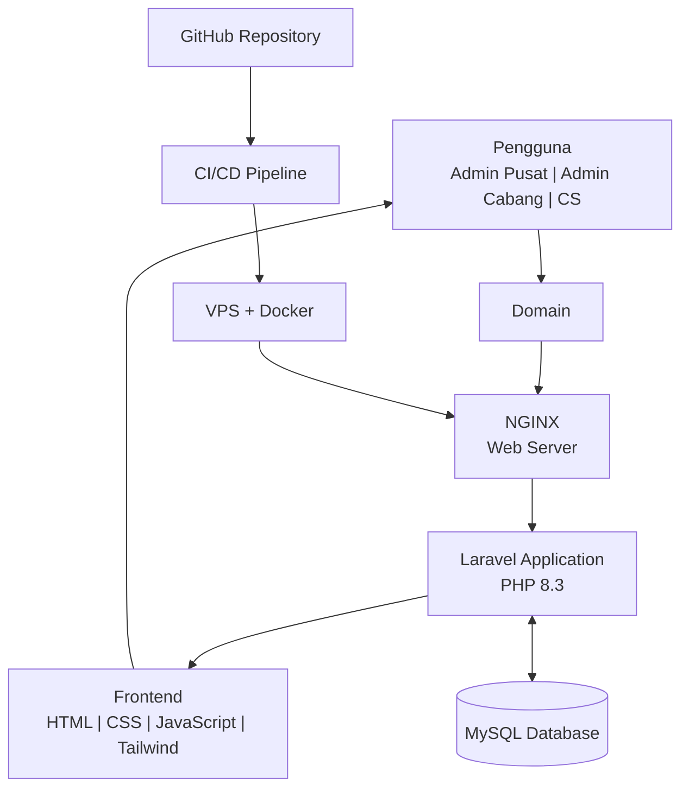

 <p align="center">
  
</p>

<p align="center">
  <strong>Sistem Informasi Transaksi Akuntansi</strong><br>
  Aplikasi Berbasis Web untuk Pengelolaan Transaksi dan Keuangan Usaha Percetakan
</p>

<p align="center">
  
  
  
  
  
</p>

---

## About SISTA

**SISTA (Sistem Informasi Transaksi Akuntansi)** merupakan aplikasi berbasis web yang dikembangkan untuk membantu pengelolaan transaksi penjualan dan pencatatan keuangan pada usaha percetakan. Sistem ini mengintegrasikan proses transaksi penjualan, pengelolaan pengeluaran, persediaan bahan baku, hingga penyusunan laporan akuntansi dalam satu aplikasi.

### Background

Usaha percetakan memiliki berbagai aktivitas operasional, mulai dari transaksi penjualan, pengelolaan bahan baku, hingga pencatatan pengeluaran. Apabila proses tersebut masih dilakukan secara manual dan menggunakan aplikasi yang terpisah, pengelolaan serta rekapitulasi data keuangan membutuhkan proses tambahan.

Oleh karena itu, dikembangkan SISTA sebagai sistem informasi berbasis web yang dapat mengintegrasikan pencatatan transaksi penjualan dan pengelolaan keuangan sehingga data lebih terstruktur dan mudah dikelola.

### Objectives

Pengembangan SISTA bertujuan untuk:

- Mempermudah proses pencatatan transaksi penjualan.
- Mengintegrasikan data transaksi penjualan dan pengeluaran.
- Membantu pengelolaan pembelian serta persediaan bahan baku.
- Mengotomatisasi pencatatan jurnal berdasarkan transaksi.
- Mempermudah penyusunan buku besar dan laporan laba rugi.
- Menyediakan informasi keuangan berdasarkan periode dan cabang.
- Mendukung pengelolaan data melalui pembagian hak akses pengguna.

## Features

### 1. User Management
- Login dan autentikasi pengguna.
- Pengelolaan data pengguna.
- Pengelolaan data cabang.
- Pembagian hak akses berdasarkan peran pengguna.

### 2. Sales Transaction
- Pencatatan transaksi penjualan.
- Pengelolaan informasi pelanggan.
- Pemilihan produk dan jumlah pesanan.
- Perhitungan subtotal dan total transaksi.
- Pembuatan nomor referensi transaksi.
- Pengurangan stok bahan baku berdasarkan komposisi produk.
- Pembuatan jurnal transaksi secara otomatis.

### 3. Product Management
- Pengelolaan data produk.
- Pengaturan satuan dan harga jual.
- Pengelolaan harga pokok produksi (HPP).
- Pengaturan komposisi bahan baku produk.

### 4. Raw Material Management
- Pengelolaan data bahan baku.
- Pencatatan pembelian bahan baku.
- Pemantauan stok bahan baku.
- Pembaruan stok berdasarkan pembelian dan transaksi penjualan.
- Perhitungan harga rata-rata bahan baku.

### 5. Expense Management
- Pencatatan pengeluaran operasional.
- Pengelompokan pengeluaran berdasarkan akun.
- Pengelolaan data pengeluaran berdasarkan cabang.

### 6. Financial Reports
- Jurnal umum.
- Buku besar.
- Laporan laba rugi.
- Penyajian laporan berdasarkan periode dan cabang.
- Ekspor laporan transaksi ke PDF dan Excel.

## User Roles

SISTA memiliki tiga jenis pengguna dengan hak akses yang berbeda.

| Role | Description |
|---|---|
| Admin Pusat | Mengelola data pusat, cabang, pengguna, akun, serta memantau informasi transaksi dan keuangan. |
| Admin Cabang | Mengelola data operasional dan keuangan sesuai dengan cabang yang menjadi tanggung jawabnya. |
| Customer Service | Melakukan pencatatan transaksi penjualan berdasarkan pesanan pelanggan. |

## Technology Stack

Teknologi yang digunakan dalam pengembangan SISTA:

| Technology | Description |
|---|---|
| PHP 8.3 | Backend Programming Language |
| Laravel 13 | Backend Framework |
| HTML5 | Markup Language |
| CSS3 | Stylesheet Language |
| JavaScript | Frontend Programming Language |
| Tailwind CSS | CSS Framework |
| MySQL | Database Management System |
| NGINX | Web Server |
| Docker | Containerization |
| GitHub | Version Control |
| Maatwebsite Excel | Excel Export |
| Laravel DomPDF | PDF Generation |

## System Architecture

SISTA menggunakan arsitektur aplikasi berbasis web yang menghubungkan pengguna, domain, web server, aplikasi Laravel, dan database MySQL.

### Architecture Diagram



### Architecture Components

- **User:** Pengguna yang mengakses aplikasi melalui browser.
- **Domain:** Alamat untuk mengakses aplikasi.
- **NGINX:** Menerima permintaan pengguna dan meneruskannya ke aplikasi Laravel.
- **Laravel:** Menangani autentikasi, proses bisnis, dan pengolahan data.
- **Frontend:** Menampilkan antarmuka aplikasi kepada pengguna.
- **MySQL:** Menyimpan data pengguna, cabang, produk, transaksi, bahan baku, dan informasi akuntansi.
- **Docker:** Menjalankan aplikasi dan layanan pendukung dalam container.
- **VPS:** Server untuk menjalankan aplikasi agar dapat diakses melalui internet.
- **GitHub:** Menyimpan kode sumber dan mendukung pengelolaan versi aplikasi.
- **CI/CD:** Mendukung proses integrasi dan deployment aplikasi apabila pipeline telah dikonfigurasi.

## Installation

Ikuti langkah-langkah berikut untuk menjalankan SISTA pada lingkungan lokal menggunakan Docker.

### Requirements

Pastikan perangkat telah memiliki:

- Git
- Docker Desktop
- Docker Compose
- Web Browser
- Koneksi Internet

### 1. Clone Repository

```bash
git clone https://github.com/jonathansiallagan/sistem-akuntansi-percetakan.git
```

Masuk ke direktori proyek:

```bash
cd sistem-akuntansi-percetakan
```

### 2. Install Additional Packages

Pasang package untuk kebutuhan ekspor Excel dan pembuatan dokumen PDF:

```bash
composer require maatwebsite/excel
composer require barryvdh/laravel-dompdf
```

### 3. Environment Configuration

Salin file environment:

```bash
cp .env.example .env
```

Sesuaikan konfigurasi pada file `.env`:

```env
APP_NAME=SISTA
APP_ENV=local
APP_DEBUG=true
APP_URL=http://localhost

DB_CONNECTION=mysql
DB_HOST=mysql
DB_PORT=3306
DB_DATABASE=db_percetakan
DB_USERNAME=root
DB_PASSWORD=password
```

Sesuaikan konfigurasi database dengan pengaturan pada file Docker Compose.

### 4. Build and Run Docker

Pastikan Docker Desktop sudah berjalan, kemudian jalankan:

```bash
docker compose up -d --build
```

Periksa status container:

```bash
docker compose ps
```

### 5. Install Laravel Dependencies

Jalankan perintah berikut melalui container aplikasi:

```bash
docker compose exec app composer install
```

Generate application key:

```bash
docker compose exec app php artisan key:generate
```

### 6. Run Database Migration

Jalankan migration dan seeder:

```bash
docker compose exec app php artisan migrate --seed
```

### 7. Access Application

Buka browser dan akses:

```text
http://localhost
```

Jika menggunakan port khusus, sesuaikan alamat dengan konfigurasi Docker Compose.

> **Note:** Nama service `app` dan `mysql` pada contoh konfigurasi harus disesuaikan dengan nama service dalam file Docker Compose. Perintah Composer juga membutuhkan Composer yang tersedia di lingkungan tempat perintah dijalankan.

## Docker Commands

Beberapa perintah Docker yang berguna selama pengembangan:

| Command | Description |
|---|---|
| `docker compose up -d --build` | Build dan menjalankan container |
| `docker compose ps` | Melihat status container |
| `docker compose logs -f` | Melihat log layanan |
| `docker compose down` | Menghentikan dan menghapus container |
| `docker compose restart` | Memulai ulang layanan |
| `docker compose exec app php artisan migrate` | Menjalankan migration |
| `docker compose exec app php artisan optimize:clear` | Membersihkan cache Laravel |

## Project Structure

Gambaran umum struktur direktori aplikasi Laravel:

```bash
sistem-akuntansi-percetakan/
├── app/
│   ├── Http/
│   ├── Models/
│   └── Providers/
├── bootstrap/
├── config/
├── database/
│   ├── migrations/
│   └── seeders/
├── public/
├── resources/
│   ├── css/
│   ├── js/
│   └── views/
├── routes/
├── storage/
├── tests/
├── Dockerfile
├── compose.yaml
├── composer.json
├── package.json
├── .env.example
└── README.md
```

*Struktur direktori di atas merupakan gambaran umum dan perlu disesuaikan dengan repository sebenarnya.*

## Development

SISTA dapat dikembangkan lebih lanjut sesuai kebutuhan operasional usaha percetakan, termasuk penyempurnaan fitur, peningkatan keamanan, optimalisasi performa, serta pengembangan integrasi dan proses deployment.

---

<p align="center">
  <strong>SISTA – Sistem Informasi Transaksi Akuntansi</strong><br>
  Web-Based Accounting Transaction Management System
</p>